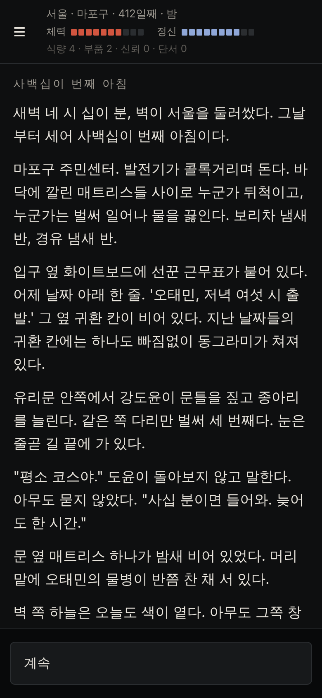
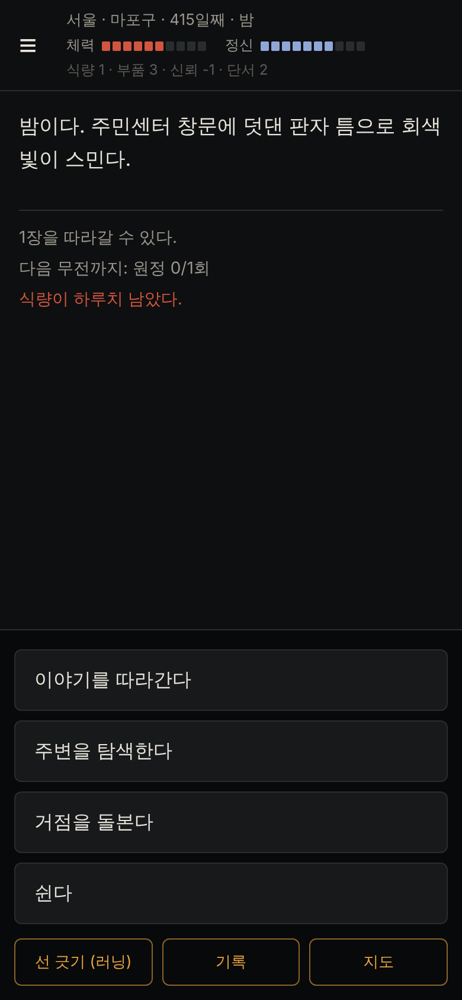
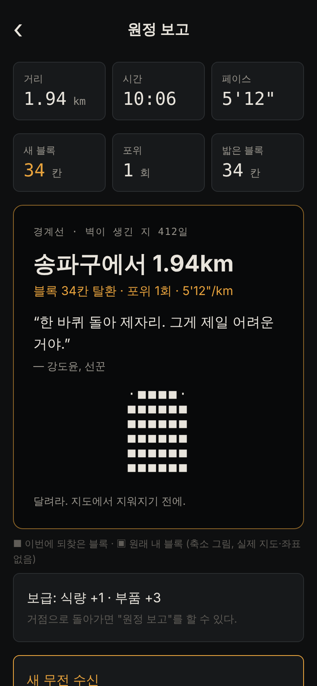
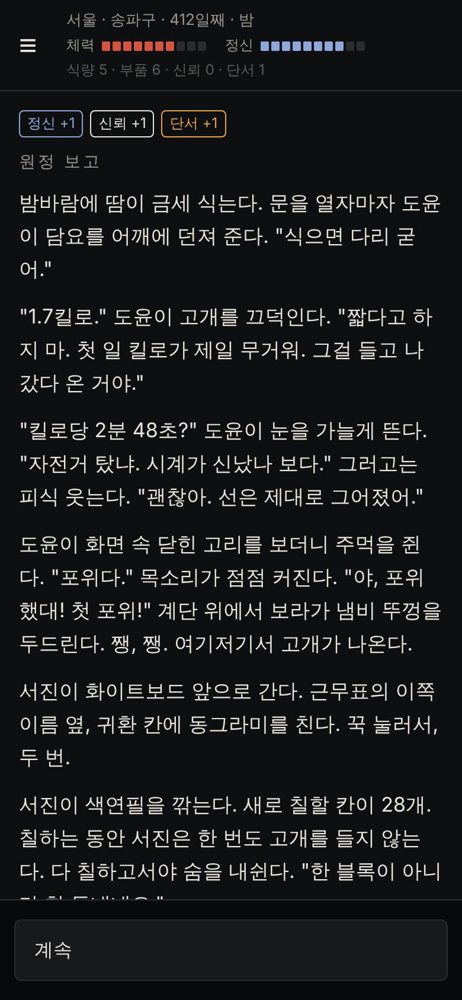
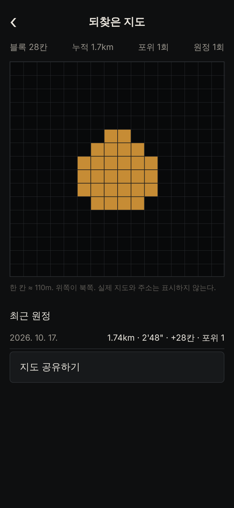

# 경계선 (가제)

> 달려라. 지도에서 지워지기 전에.

대한민국의 모든 시·군이 경계선을 따라 벽에 갇힌 지 412일. **내가 실제로 있는 동네**에서 시작하는 생존 텍스트 RPG이고, **실제로 달린 길**이 이야기 속 지도를 되찾는다.

- **어디서든 무대:** 전국 229개 시·군·구 어디서 켜든 그곳이 거점이 된다. 해외에서 켜면 벽 바깥에서 들어온 외부인이 된다. 위치를 쓰지 않으면 직접 고른다.
- **분기 스토리:** 8장, 엔딩 7개. 체력·정신·식량·부품·신뢰·단서를 관리한다. 대도시·중소도시·농어촌·해안 이벤트가 따로 있고, 종로·마포·영등포·송파·해운대·유성에는 그 동네만의 이야기가 있다.
- **러닝 모드(선택):** 달린 길의 블록(약 110m)을 되찾고, 고리를 닫으면 안쪽까지 되찾는다. 원정 보고, 무전 기록 12편, 이미지 공유 카드가 있다. Strava·Garmin 등에서 내보낸 GPX 기록도 가져올 수 있다. 클라이맥스에서 지도 AI가 플레이어의 실제 기록을 읽는다.
- **위치 정보 보호:** 위치 좌표는 기기 밖으로 나가지 않는다. "항상 허용" 위치 권한을 요청하지 않는다.

**웹 데모:** https://claude.ai/artifact/LNMqNqv1MRrRjUkqvvm5JJ (비공개 링크, 위치·러닝 기능 제외. 시작 구역을 직접 골라 플레이한다)

## 화면

| 프롤로그 | 허브 | 원정 결과 | 원정 보고 | 되찾은 지도 |
| --- | --- | --- | --- | --- |
|  |  |  |  |  |

## 바로 실행

```bash
npm install
npm start        # 휴대폰에 Expo Go를 설치하고 QR 스캔 (러닝은 화면을 켜 둔 채로)
npm run web      # 브라우저에서 실행
```

터미널에서 스토리만 플레이해 보려면:

```bash
node scripts/play-cli.mjs new --save /tmp/p.json --dome 부산 --area 해운대구 --coastal --key busan_haeundae
node scripts/play-cli.mjs choose 0 --save /tmp/p.json
node scripts/play-cli.mjs run --save /tmp/p.json --km 5 --loop   # 러닝을 다녀온 것으로 가정
```

## 검증

```bash
npm run check    # 스토리 컴파일 + 자동 플레이 1500회 + 타입 검사 + 단위 테스트 56개
```

## 문서

| 문서 | 내용 |
| --- | --- |
| [인수인계서](docs/HANDOVER.md) | **여기부터 읽기.** 현재 상태, 남은 일, 오너가 할 일 |
| [00. 컨셉과 냉정한 검토](docs/00-concept-review.md) | 한 장 요약, 약점, 바이럴 고리, 지표와 손절 기준, 플레이테스트 결과 |
| [01. 아이데이션](docs/01-ideation.md) | 결정 기록 |
| [02. 러닝 모드](docs/02-running-mode.md) | KYRO·INTVL·ZRX 레퍼런스, 땅따먹기 설계, 안전·법·치트, 로드맵 |
| [03. 기술 설계](docs/03-tech-design.md) | 구조, 빌드·출시, 광고·결제 연결 |
| [04. 스토리 바이블](docs/04-story-bible.md) | 세계관, 인물, 3막, 엔딩 |
| [05. 스토리 작성 가이드](docs/05-story-guide.md) | ink 작성 규칙 |
